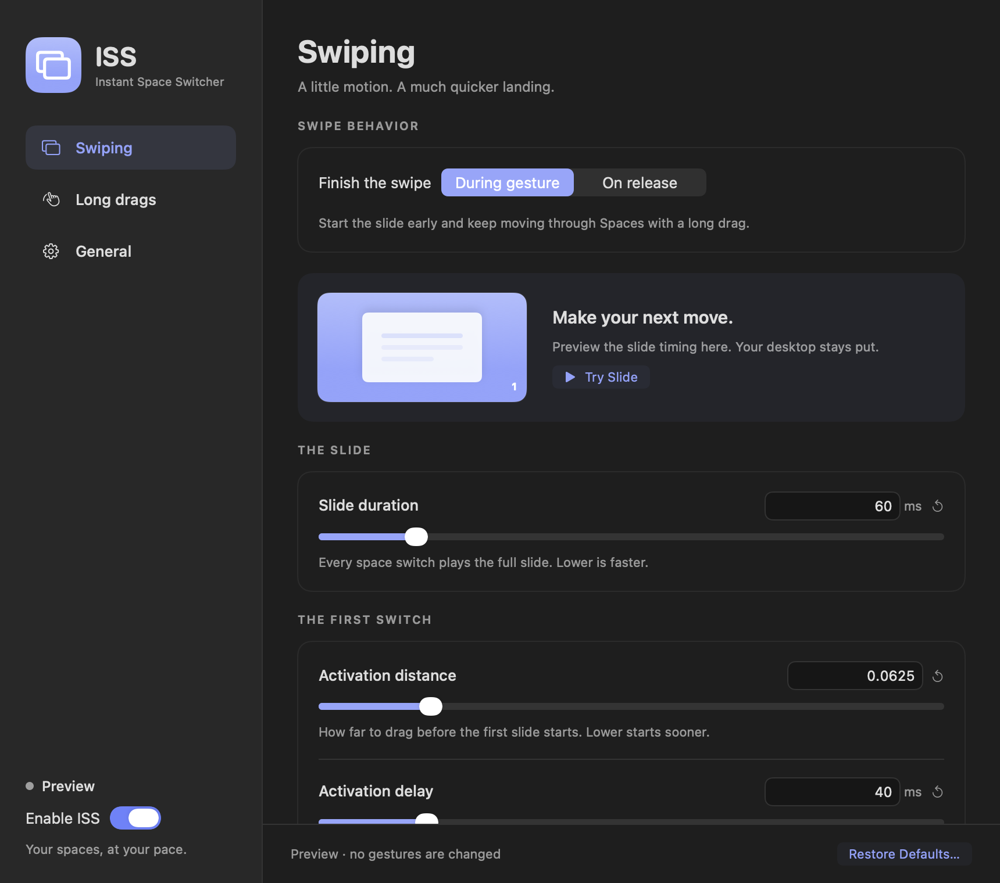
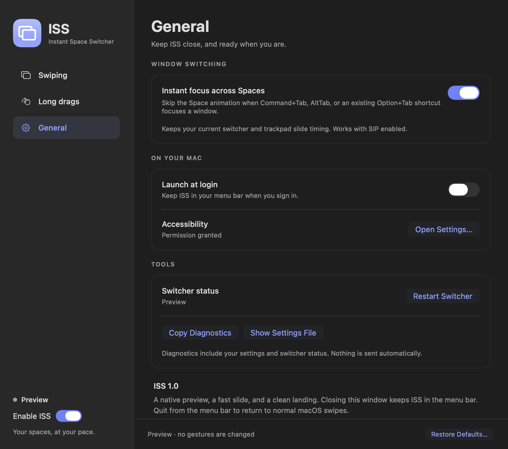

# ISS

Instant Space Switcher is a small macOS menu bar app that makes moving between desktops feel quicker. It keeps the familiar trackpad preview and finishes each switch with a short slide. You can adjust the timing, swipe through several Spaces in one gesture, and skip the Space animation when switching to a window on another desktop.



## Install

You'll need macOS and the Xcode command-line tools. If you don't have the tools, run `xcode-select --install` first.

From this project's folder:

```sh
./build-and-install.sh
```

This builds, signs, and installs ISS in `~/Applications`, then opens it. Quit ISS before running the script again to update it. For a different location:

```sh
./build-and-install.sh APP_INSTALL_DIR=/Applications
```

If you previously installed the command-line service with `make install`, run `make uninstall` first. Stop any foreground `./iss` process too.

## Getting started

1. Allow **ISS** in **System Settings → Privacy & Security → Accessibility**. If **iss-engine** appears separately, allow it too.
2. Swipe between desktops as usual. The default slide takes 60 ms.
3. Open **Swiping** to adjust the speed. **Try Slide** previews the timing without moving your desktop.
4. Turn on **Launch at login** under **General** if you'd like ISS to start when you sign in.

Settings save automatically and apply to your next swipe. Closing the window leaves ISS in the menu bar. Use its menu to reopen settings, pause, or quit. Pausing or quitting returns swipes to normal macOS behavior.

## Make it feel right

**During gesture** starts the slide while your fingers are still down. Keep dragging to move through more Spaces, or reverse to go back. The **Long drags** page controls the distance between switches and the pause on each desktop.

**On release** follows your fingers until you lift, then slides to a Space based on your movement. The gesture speed multiplier changes how far a drag travels. Acceleration adds extra movement to faster swipes; leave it at 0 to turn it off.

Both modes stop at the first and last desktop. Mission Control and vertical swipes work as usual. You can type values directly into the settings fields, reset individual controls, or use **Restore Defaults** to start over.

Under **General**, **Instant focus across Spaces** skips the Space animation when Command+Tab, AltTab, or a Dock click takes you to a window on another desktop.



*Screenshots show the app in preview mode.*

## If something isn't working

Check Accessibility permission, then use **General → Restart Switcher**. After rebuilding, macOS may require you to re-enable permission. Avoid running the app alongside the old command-line service or another Space-switching utility.

ISS uses private macOS APIs, so compatibility can change with macOS updates. It works with SIP enabled. Settings stay on your Mac, and diagnostics are only copied when you ask.

## Build and test

```sh
make app
make test
make test-app
```

For a look at the UI without changing gestures:

```sh
build/ISS.app/Contents/MacOS/ISS --preview
```

The optional command-line service is available with `make install` and removed with `make uninstall`. Use either the app or the service.

## Uninstall

Turn off **Launch at login**, quit ISS, and delete `~/Applications/ISS.app`. Your settings remain in `~/Library/Application Support/ISS/settings.plist` if you want to keep them for later.

## Credits

ISS draws on work from [FasterSwiper](https://github.com/mgbowen/FasterSwiper), [spaceflick](https://github.com/julienR2/spaceflick), [noswoosh](https://github.com/mmathys/noswoosh), and [yabai](https://github.com/asmvik/yabai). See [third-party notices](THIRD_PARTY_NOTICES.md) for details and [LICENSE](LICENSE) for the project license.
